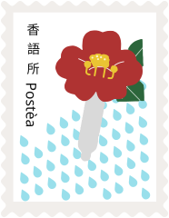

  

# Postèa 香語所

每一瓶香，都是一則心事。

在香語所，每一瓶香，都是一則心事。將心意封存，待開瓶時，氣味會代替說完那句沒說出口的話。

把它想成一封信。郵票蓋上，話還留在紙上，先封進瓶子裡。開瓶的那一刻，氣味會替你說完。

香語所是 Tina 在台北的調香工作室。瓶子不大，一次只陪幾個人，把還沒說出口的心意調進氣味裡。

## 調香探索與體驗

為你一個人調的香。

想要一瓶真正屬於自己的香水嗎？Tina 會陪你一對一聊聊喜歡的氣味、記憶和心情，從香料櫃裡一支一支找出你的味道，調成獨一無二的配方。也可以約朋友、伴侶一起來，兩到四人同行，各自調出自己的那一瓶。約 1.5 到 2 小時，帶走一瓶 30ml 淡香水，或一瓶空間噴霧，讓家裡也有你的味道。

- 一對一 NT$2,000
- 兩人同行，每人 NT$1,800
- 三至四人同行，每人 NT$1,600
- 時長：約 1.5 至 2 小時
- 成品：30ml 淡香水或空間噴霧（二選一）

## 每月主題調香

一群人，一起走進這個月的香氣故事。

每個月一個主題，像 11 月是「桂花茶室」。大家從同一款主題基底出發，跟著 Tina 聞香、玩香，再加入自己喜歡的方向。中間一起喝茶、分享彼此調出的味道，最後各自帶走一瓶 10ml 的主題香水。

- 每人 NT$800
- 成品：10ml 主題香水

第一場是「桂花茶室」每月主題調香小聚 #1。2026 年 11 月 21 日，14:00–16:15，在台北市｜捷運南京復興站旁（詳細地址報名後通知）。4–10 人，滿 4 人開課。帶走 10ml 桂花茶室香水一瓶，以及一張個人配方卡。

秋天的台北，巷子裡飄著桂花香。每個人從同一杯「桂花茶」出發，最後帶走的那一瓶，是「我心中的那間茶室」。Tina 會帶大家一支一支聞香、講解，中場一起喝一壺桂花烏龍，分享彼此調出的茶室。

## 怎麼選？

第一次接觸調香、想輕鬆體驗、喜歡和大家一起玩，選每月主題調香。

想要專屬於自己、更深入的調香時光，或想送給重要的人一份特別的禮物，選調香探索與體驗。

## 寫一封來

- 網站 [postea.cc](https://postea.cc)
- Instagram [@postea.scent](https://www.instagram.com/postea.scent/)
- LINE [@144eqxql](https://line.me/R/ti/p/@144eqxql)

網站維護說明請見 [docs/維護說明.md](docs/維護說明.md)。
